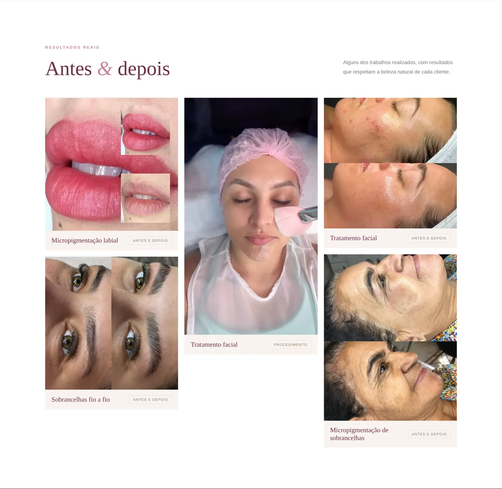

# Thaise Silvério — Micropigmentação e Estética

Site institucional de uma profissional de micropigmentação e estética. Ele apresenta
os procedimentos, mostra resultados reais de antes e depois e leva a cliente direto
para uma conversa no WhatsApp, já com a mensagem pronta.

🔗 **Site no ar:** https://thaise-silverio.pages.dev


<p align="center">
  
</p>

## O problema que o site resolve

Uma rede social mostra o trabalho, mas espalhado entre muitas publicações. O site
reúne num endereço próprio tudo o que uma cliente precisa para decidir: quem é a profissional, quais procedimentos
ela faz, resultados reais e um caminho curto até o agendamento. Cada botão
"Saiba mais" abre o WhatsApp com o nome do procedimento escrito, para a cliente não
precisar explicar o que quer.

## Funcionalidades

- **Página única** com as seções Início, Sobre, Procedimentos, Resultados, Cursos e Contato.
- **Agendamento pelo WhatsApp** com mensagem pronta para cada procedimento e para os cursos.
- **Galeria "Antes & depois"** com fotos reais, autorizadas pelas clientes.
- **Biografia** da profissional, com destaques (+500 clientes, 6 anos de experiência).
- **Layout responsivo**: 3, 2 ou 1 coluna conforme o tamanho da tela.
- **Prévia de compartilhamento**: o link mostra um card com foto quando é enviado no
  WhatsApp, no Instagram ou no Facebook (Open Graph).
- **Favicon** e ícone para a tela inicial do celular.



## Tecnologias

| Área       | Tecnologia                                                             |
| ---------- | ---------------------------------------------------------------------- |
| Framework  | [Next.js 16](https://nextjs.org/) (App Router) com exportação estática |
| Interface  | React 19 + TypeScript                                                  |
| Estilo     | CSS puro, com variáveis para a paleta de cores                         |
| Formatação | Prettier                                                               |
| Hospedagem | Cloudflare Pages (deploy automático a cada merge na `main`)            |

## Decisões técnicas

- **Site estático (`output: "export"`).** Um site de apresentação não precisa de
  servidor. O build gera HTML puro na pasta `out/`, então a hospedagem é gratuita e
  rápida, e não sobra servidor para manter nem para ser atacado.
- **Conteúdo separado do visual.** Número do WhatsApp, Instagram, procedimentos e
  galeria ficam em `lib/site.ts`. Para trocar um texto ou uma foto não é preciso
  mexer nos componentes, e cada informação existe em um lugar só.
- **Paleta em variáveis CSS.** As cores ficam no `:root` de `app/globals.css`. A
  troca da paleta azul pela rosé foi feita mudando só esses valores.
- **Imagens otimizadas.** As fotos foram convertidas para WebP (de até 417 KB para 30 a
  90 KB), tiveram os metadados removidos (como a localização GPS) e receberam texto
  alternativo descritivo.
- **Acessibilidade.** Tamanho mínimo de texto, enfeites ignorados por leitores de tela
  (`aria-hidden`), links com nome completo ("Saiba mais sobre Hidralips") e HTML
  semântico (`header`, `main`, `nav`, `footer`).
- **Segurança.** Cabeçalhos HTTP em `public/_headers` (proteção contra clickjacking,
  `nosniff`, `Referrer-Policy`, `Permissions-Policy`), dependências sem
  vulnerabilidades conhecidas e nenhuma chave no código.

## Estrutura

```
app/
  layout.tsx        metadados, SEO e prévia de compartilhamento
  page.tsx          monta as seções na ordem
  globals.css       estilos e paleta de cores
  icon.png          favicon (monograma da logo)
components/         uma seção por arquivo (Header, Hero, About, Services,
                    Results, Courses, Contact, Footer)
lib/site.ts         dados editáveis: endereço do site, WhatsApp, Instagram,
                    procedimentos e galeria
public/
  images/           logo, foto da Thaise e fotos de resultados
  og-image.jpg      imagem da prévia de compartilhamento
  _headers          cabeçalhos de segurança e cache (Cloudflare Pages)
docs/screenshots/   capturas usadas neste README
CLAUDE.md           guia para agentes de IA que trabalham no projeto
```

## Como rodar localmente

Requer **Node.js 20 ou superior** (o projeto usa o 22, definido em `.nvmrc`).

1. Clone o repositório:
   ```bash
   git clone https://github.com/Yuric9/thaise-silverio.git
   ```
2. Entre na pasta e instale as dependências:
   ```bash
   cd thaise-silverio
   npm install
   ```
3. Inicie o servidor de desenvolvimento:
   ```bash
   npm run dev
   ```
4. Acesse http://localhost:3000.

| Comando          | O que faz                                          |
| ---------------- | -------------------------------------------------- |
| `npm run dev`    | Servidor de desenvolvimento com recarga automática |
| `npm run build`  | Gera a versão estática na pasta `out/`             |
| `npm run format` | Formata o código com o Prettier                    |

O projeto não usa variáveis de ambiente nem banco de dados.

## Como editar o conteúdo

| Quero mudar...      | Onde                                                                                            |
| ------------------- | ----------------------------------------------------------------------------------------------- |
| Número do WhatsApp  | `WHATSAPP_NUMBER` e `WHATSAPP_DISPLAY` em `lib/site.ts`                                         |
| Instagram           | `INSTAGRAM_HANDLE` em `lib/site.ts`                                                             |
| Procedimentos       | lista `services` em `lib/site.ts`                                                               |
| Fotos de resultados | coloque o arquivo em `public/images/resultados/` e adicione na lista `results` em `lib/site.ts` |
| Cores               | variáveis no início de `app/globals.css`                                                        |
| Textos das seções   | arquivo da seção em `components/`                                                               |

## Deploy

O site é publicado na **Cloudflare Pages**, conectada a este repositório. Cada merge
na branch `main` gera um novo deploy automaticamente.

Configuração do projeto na Cloudflare:

- **Framework preset:** Next.js (Static HTML Export)
- **Build command:** `npm run build`
- **Build output directory:** `out`
- **Node.js:** lido do arquivo `.nvmrc` (22)

**Voltar a uma versão anterior (rollback):** no painel da Cloudflare, abra o projeto,
vá em **Deployments**, escolha uma publicação anterior e use
**Rollback to this deployment**.

Ao passar a usar um domínio próprio, atualize `SITE_URL` em `lib/site.ts`. Ele é
usado na prévia de compartilhamento.

## Próximos passos

- Cidade e endereço de atendimento (melhora a busca local no Google).
- Técnicas de micropigmentação que a profissional domina.
- Perguntas frequentes ("Dói?", "Quanto tempo dura?", "Quais os cuidados depois?").
- Menu recolhível (hambúrguer) no celular.
- Domínio próprio.
- Depoimentos de clientes.

## Autor

Desenvolvido por [Yuric9](https://github.com/Yuric9), com apoio de IA (Claude Code).

Conteúdo, fotos e marca pertencem a Thaise Silvério. O site de referência foi usado
somente como inspiração de estrutura e experiência. Marca, textos e conteúdo visual
foram preparados para Thaise Silvério.
